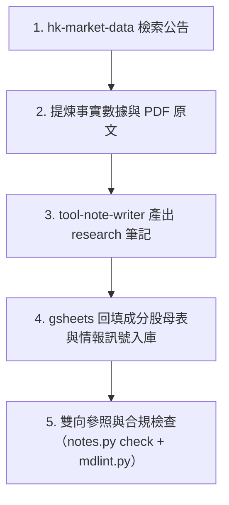

# 00882 成分股股利調查與 Google Sheets 同步工作流

本工作流為 Antigravity 本地自動化標準作業程序（SOP），負責自港交所披露易檢索 00882 成分股最新分紅公告，產出獨立標的研究筆記，並自動同步至 Google Drive 原生 Google Sheet。

---

## 1. 觸發時機

- **除息季定期檢索**：港股中期分紅季（9～11 月）與年度分紅季（3～5 月）。
- **重大公告發布時**：核心成分股（中遠海控、國有大行、神華等）發布盈喜、盈利預警或分紅派息公告。
- **使用者明確指令**：使用者要求「查成分股最新消息/公告」、「更新成分股股利調查」時觸發。

---

## 2. 標準執行步驟



### 步驟 1：檢索港交所披露易官方公告

使用專案內建的 `hk-market-data` 腳本，透過 Python 連線披露易：

```bash
# 檢索 00882 全數 49 檔成分股近兩週公告
python3 .claude/skills/hk-market-data/scripts/hkdata.py sectors --announce-days 14

# 針對核心權重股檢索近 30 天詳細公告
python3 .claude/skills/hk-market-data/scripts/hkdata.py announce 1919 0939 1398 3988 1288 1088 0998 1766 --days 30
```

### 步驟 2：解析 PDF 提煉硬事實

利用 `hkdata.py pdf` 抓取並解析公告關鍵字，提取每股股息、除息日與現金發放日：

```bash
python3 .claude/skills/hk-market-data/scripts/hkdata.py pdf <披露易PDF網址> --grep "Dividend declared|Ex-dividend|Payment"
```

### 步驟 3：使用筆記技能歸納至 `research/`

依據 `format-research.md` 規範，在 REPO 的 `research/` 目錄建立或更新獨立研究筆記（例如 `research/00882_成分股股利調查.md`）：

- **遵循六大必填段落**：摘要、論點、依據、風險與反方觀點、追蹤指標、更新紀錄。
- **事實與觀點分開**：依據段落記錄客觀除息表格與 PDF 原文連結；論點段落記錄對現金流與分紅常態化的解讀。

### 步驟 4：回填成分股母表與提煉情報訊號

1. **回填母表「00882_成分股股利資料庫」**（ID `1Jq599WzoQUDsooZDhJhyK8uaEMgDiLLCoZthWk2WXtw`，在 `Portfolio_00882/成分股股利資料庫`）：
   - 讀取分頁「成分股」現有內容。
   - 將查得的最新分紅數據更新至對應成分股代號列的 `interim2026` 欄位（例如「派息每股0.43元」）。
   - 維護現有母表單一真實來源，**嚴禁隨意另建孤立試算表**，確保 Stock_AIStudio APP 讀取之資料庫始終保持同步。

2. **提煉硬數據至「情報資料庫」**（ID `1BF2xvF0cmyODdN0nXR8QHbOTC3ikqswvSwBboY1cGQo`，在 `Portfolio_00882/情報與趨勢`）：
   - 依據 `references/intel-sheet.md` 規格，將具代表性之重大分紅數據提煉為標準訊號列（`id` 為 `sig-YYYY-MM-DD-流水號`）。
   - 事實放 `hardFacts`/`extractedMetrics`，推論放 `objectiveReasoning`（標「此為推論」），出處標記港交所公告原文。
   - 使用 `gsheets` 寫入 `Untitled` 分頁，並依規則刷新 `評分歷史` 分頁。

### 步驟 5：雙向參照與合規檢查

1. **筆記連結**：在 research 筆記的 `sources` 欄位確保指引至母表與公告出處。
2. **合規驗證**：

   ```bash
   python3 .claude/skills/tool-note-writer/scripts/notes.py check
   python3 .claude/skills/markdown-linter/scripts/mdlint.py
   ```

---

## 3. 注意事項與禁止規則

1. **嚴禁 CSV 混入**：上傳至 Google Drive 的檔案必須為原生 Google Workspace 格式（`.gsheet`），不保留中介 `.csv` 或 `.md`。
2. **禁止修改 Core**：本工作流只操作 `Portfolio_00882/成分股股利資料庫/`，**嚴禁修改 `Investment_Tracker_Core`**。
3. **保持獨立性**：00882 整體 ETF 的歷年配息由 `models/00882/profile/actual_payouts.yml` 管理；成分股個別調查維持獨立筆記與獨立 Sheet，兩者不混為一談。
