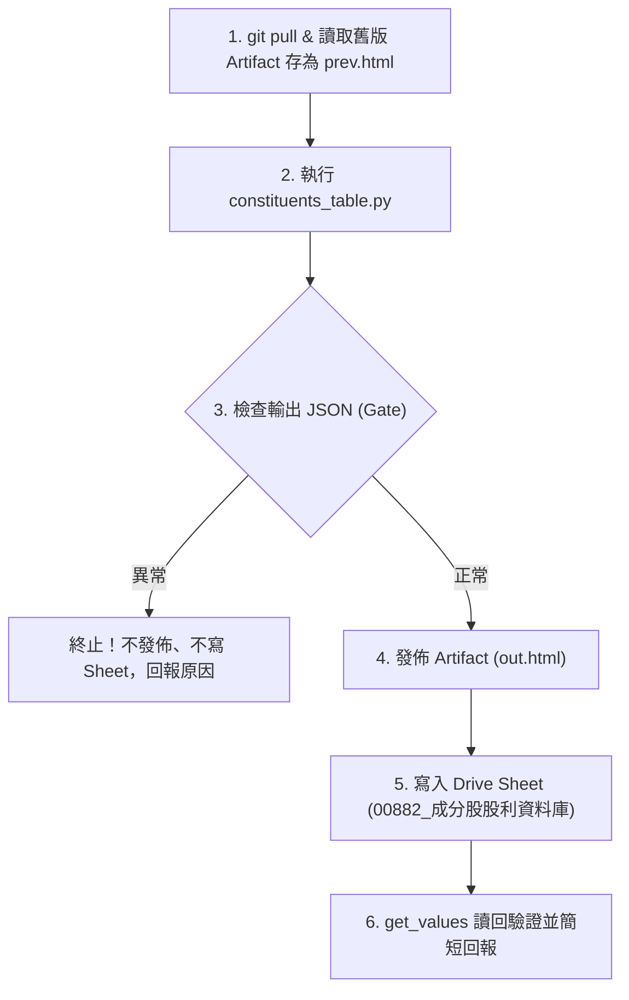

# 00882 成分股股利表排程工作流

本工作流為 00882 成分股股利明細與財報資料表之標準作業程序（SOP），規格收斂於 Git REPO 作為單一真實來源（SSOT），由 Claude 雲端定時排程執行產出，供 Stock_AIStudio APP 股利頁免登入讀取。

---

## 1. 觸發時機與排程

- **排程頻率**：每週五 17:00（港股 16:10 收盤且相關投信與市場結算後）。
- **觸發平台**：Claude 雲端排程。
- **雲端排程 Prompt（單行呼叫）**：

  ```text
  git pull origin main，讀取並執行 .claude/workflows/hk-00882-dividend.md，完成後依規格回報。
  ```

---

## 2. 執行前置與環境

- **工作目錄**：REPO 根目錄。
- **前置動作**：
  1. `git pull origin main`。
  2. 腳本位置：`.claude/skills/hk-market-data/scripts/constituents_table.py`（範本會自動由 references 讀取，若找不到腳本即回報並停止）。
  3. 用 Artifact 工具讀取目前 `https://claude.ai/artifact/DSbfrxfywurJVo3TVwSzia` 之內容，存成本地 `/tmp/prev.html`（或 `prev.html`）。
- **網路許可網域**（僅雲端沙盒需設）：
  `ctbcinvestments.com.tw`, `datacenter.eastmoney.com`, `google.com`, `query1.finance.yahoo.com`。

---

## 3. 標準執行步驟



### 步驟 1：執行成分股運算核心指令

在 REPO 根目錄執行：

```bash
python3 .claude/skills/hk-market-data/scripts/constituents_table.py out.html prev.html table.json --gate
```

*耗時約 1 分鐘，不需背景執行，不依賴無頭瀏覽器。*

### 步驟 2：健康檢查門檻判定（Gatekeeper）

解析標準輸出之 JSON 物件，必須滿足以下條件才可繼續：

- `rows`：約 49 檔。
- `fails`：必須為空清單 `[]`。
- `has26`：$\ge 20$ 檔（已有 2026 中期分紅意向或公告）。
- `fin_fails`：不超過 5 檔。

🚨 **異常處置**：若 `fails` 超過 5 檔、`fin_fails` 超過 5 檔，或連不上目標網域，**立即停止，不發佈 Artifact 也不寫入 Sheet**，回報具體原因。

*說明：`fails` 代表缺股價或歷次分配的成分股，這些檔會留在網頁財報分頁，但不會寫進 Sheet；殖利率分子是已除息之最近兩次定期分配（季度分配取 4 次，年度分配取 1 次，不含特別分配）。*

### 步驟 3：Artifact 發布（Claude 雲端專屬）

- **目標 URL**：`https://claude.ai/artifact/DSbfrxfywurJVo3TVwSzia`（原地更新發布 `out.html`）。
- **頁面結構**：包含「股利明細」與「財報資料」兩個分頁。

### 步驟 4：寫入 Google Drive 試算表

依據 `architecture/APP讀取清單-Stock_AIStudio.md` 之資料庫註冊表規範：

- **試算表名稱**：`00882_成分股股利資料庫`
- **Sheet ID**：`1Jq599WzoQUDsooZDhJhyK8uaEMgDiLLCoZthWk2WXtw`（位於 `Project_財商工程/Portfolio_00882/成分股股利資料庫`，公開連結）
- **資料來源**：`table.json`

#### 分頁寫入契約

1. **分頁「成分股」**：
   - 第一列表頭：`code,name,weightPct,qty,priceHkd,divTtmHkd,divLfyHkd,chgPct,yieldTtmPct,interim2026`
   - 欄位映射：依 `table.json` 的 `rows` 欄位 `c,n,w,q,px,ttm,lfy,chg,y,i26` 一對一寫入。
   - 規則：`code` 加 `'` 前綴存成文字；`px` 為 null 填空字串。
2. **分頁「摘要」**：
   - A:C 範圍為 `key,value,note`。
   - key 依序：`asOf`（今天）、`holdingsAsOf`（`table.json` 的 `holdings_asof` 轉 YYYY-MM-DD）、`ttmUnitTwd`、`lfyUnitTwd`、`has26`、`fxHkdToTwd`、`nav`、`unitsOutstanding`、`rows`、`note`（「推估，不是官方配息；未扣管理費與預扣稅」）、`lastUpdated`、`executor`。
   - B 欄每個值（含日期與數字）**一律加 `'` 前綴存成文字**，避免 B 欄被誤判為純數字欄位而導致 APP 日期解析失敗。

#### 寫入防呆規範

- 列數變少時，把多出的舊列清成空字串，**嚴禁刪列**。
- 使用 `update_values` 寫入，不帶 `valueInputOption`。
- 寫完調用 `get_values` 讀回確認。

---

## 4. 執行回報規範

完成後以一至兩行回報：

- 更新日期、年股利合計（`ttm_unit`，TWD／單位，毛額）較上次變化、已公告中期股息檔數、Sheet 是否更新成功；註明是推估。
- **計算口徑提示**：2026-10-22 起年股利合計口徑改為「最近兩次定期分配」，若有口徑切換需於回報中特別註明，不視為實際配息波動。
- 財報分頁來源為東方財富，不寫入 Sheet。
- **嚴格禁令**：不修改 REPO 與 Core（`Investment_Tracker_Core` 嚴禁寫入）。

---

## 5. 雙 Agent 協同分工與代班邊界

- **日常運作**：本任務為「雙棲任務（Artifact + Sheet）」，日常固定由 **Claude 雲端排程** 統一完成運算、網頁發布與試算表寫入。
- **本機代班邊界**：為維護 Stock_AIStudio APP 與 Artifact 呈現之數值 100% 吻合，**Antigravity 本機不單獨代寫此 Sheet**。本機僅負責演算法改進與離線測試。
