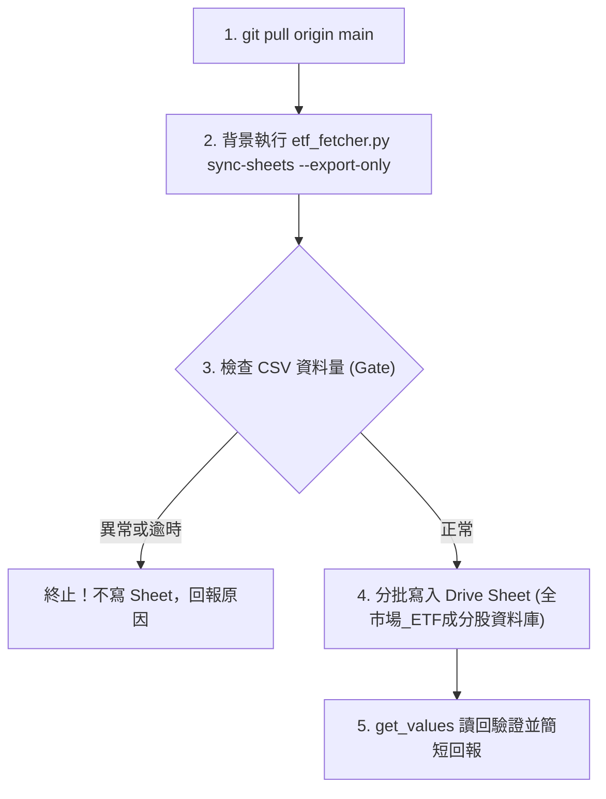

# 全市場 ETF 成分股資料庫排程工作流

本工作流為全市場 ETF 成分股與摘要資料庫之標準作業程序（SOP），規格收斂於 Git REPO 作為單一真實來源（SSOT），專供 Stock_AIStudio APP 全市場 ETF 頁面讀取。

---

## 1. 觸發時機與排程

- **排程頻率**：每週五 17:10（台北時間）。
- **觸發平台**：Claude 雲端排程（亦支援 Antigravity 本機直接代班執行）。
- **雲端排程 Prompt（單行呼叫）**：

  ```text
  git pull origin main，讀取並執行 .claude/workflows/market-etf-pool.md，完成後依規格回報。
  ```

---

## 2. 執行前置與環境

- **工作目錄**：REPO 根目錄。
- **前置動作**：`git pull origin main`。
- **產出型態**：**純 Sheet（無 Artifact）**。嚴禁發布或更新任何 Artifact，不碰 `reports/portfolio_briefing.md`。
- **網路許可網域**（僅雲端沙盒需設）：
  `query1.finance.yahoo.com`, `api.edinet-fsa.go.jp`, `data.sec.gov`, `www.sec.gov`, `api.finmindtrade.com`, `datacenter.eastmoney.com`, `openapi.twse.com.tw`。

---

## 3. 標準執行步驟



### 步驟 1：執行資料庫匯出腳本

在 REPO 根目錄執行：

```bash
python3 .claude/skills/tw-etf-fetcher/scripts/etf_fetcher.py sync-sheets --export-only --output-dir out
```

*注意：雲端無 gsheets CLI，必須帶 `--export-only`。日股 ETF 會查 EDINET，冷啟動約 1 分鐘；超過 10 分鐘即視為超時中斷，不寫入任何東西。*

### 步驟 2：健康檢查門檻判定（Gatekeeper）

檢查產出的 `out/etf_summary.csv` 與 `out/etf_constituents.csv`：

- `ETF_Summary`：必須達 **40 列以上**。
- `ETF_Constituents`：必須達 **5,000 列以上**。

🚨 **異常處置**：若任一檔案列數未達門檻，**立即停止，不寫入 Sheet**，並回報不足列數與錯誤。

### 步驟 3：寫入 Google Drive 試算表

依據 `architecture/APP讀取清單-Stock_AIStudio.md` 之資料庫註冊表規範：

- **試算表名稱**：`全市場_ETF成分股資料庫`
- **Sheet ID**：`1GIhbRyL-h96ACVjlSSW9YUFMiAItg_SP9Wi0o3WwG70`（Stock_AIStudio 讀取，欄位名與欄序固定不可改）

#### 分頁寫入契約

1. **分頁「ETF_Summary」**：
   - 表頭順序：`etf_id,etf_name,current_price,exchange,category,benchmark,constituent_count,top1_holding,top2_holding,top3_holding,weighted_roe,net_score,div_score,val_score,fric_score,last_model_update`
   - 自 A1 儲存格起完整寫入。
   - `etf_id` 強制加 `'` 前綴存成文字。
2. **分頁「ETF_Constituents」**：
   - 欄位以 CSV 表頭為準。
   - 由於資料量達 5,000 列以上，**採分批寫入（每批不超過 1,500 列）**。
   - `constituent_ticker` 與代號欄強制加 `'` 前綴存成文字。

#### 寫入防呆與互鎖

- 不帶 `valueInputOption`。
- 新資料列數少於舊資料時，把多出的舊列清成空字串，**嚴禁刪列**。
- 寫完調用 `get_values` 讀回首尾各幾列確認。
- **補跑支援**：互鎖以 `ETF_Summary` 內最新 `last_model_update` 資料日期比對；若需手動重跑可指定強制覆寫。

---

## 4. 執行回報規範

完成後以一至兩行回報：

- ETF 檔數、成分股列數、是否寫入成功、耗時。
- 註記：這是模型卡片彙整的推估，非官方資料。
- 嚴格禁令：只讀取 `Investment_Tracker_Core`，嚴禁寫入；不改程式。

---

## 5. 雙 Agent 協同分工與代班邊界

- **日常運作**：本任務為「純 Sheet 任務」，日常固定由 **Claude 雲端排程** 週五 17:10 自動執行。
- **本機代班邊界**：本任務無關聯之 Artifact，屬標準資料表。若遇 Claude 雲端逾時（超過 10 分鐘）或額度耗盡，**Antigravity 本機可直接代班執行**（使用本機 Python 環境產出並透過 `gsheets` CLI 或腳本直接推入試算表），無資料脫節風險。
