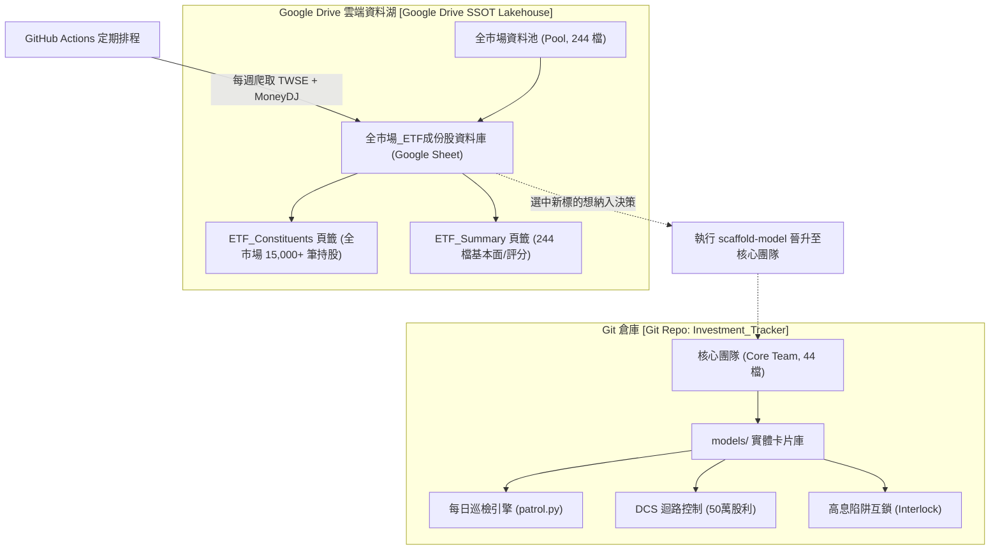
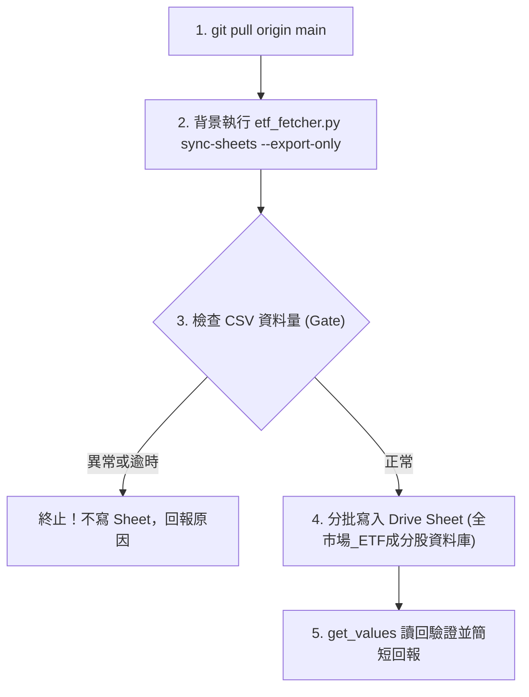

# 全市場 ETF 成分股資料庫排程工作流

本工作流為全市場 ETF 成分股與摘要資料庫之標準作業程序（SOP），規格收斂於 Git REPO 作為單一真實來源（SSOT），專供 Stock_AIStudio APP 全市場 ETF 頁面讀取。

---

## 雙軌分流架構（Hybrid Architecture）

本系統採「Git 核心團隊決策庫」與「Google Drive 全市場資料池」雙軌解耦架構：



---

## 1. 觸發時機與排程

- **排程頻率**：每週五 17:10（台北時間）。
- **觸發平台**：GitHub Actions 自動排程（亦支援 Claude 雲端排程或 Antigravity 本機手動執行）。
- **自動排程工作流**：`.github/workflows/market-etf.yml`
- **雲端排程 Prompt（單行呼叫，備用）**：

  ```text
  git pull origin main，讀取並執行 .claude/workflows/market-etf-pool.md，完成後依規格回報。
  ```

---

## 2. 執行前置與環境

- **工作目錄**：REPO 根目錄。
- **前置動作**：`git pull origin main`。
- **產出型態**：**純 Sheet（無 Artifact）**。嚴禁發布或更新任何 Artifact，不碰 `reports/portfolio_briefing.md`。
- **網路許可網域**（僅雲端沙盒需設）：
  `query1.finance.yahoo.com`, `api.edinet-fsa.go.jp`, `data.sec.gov`, `www.sec.gov`, `api.finmindtrade.com`, `datacenter.eastmoney.com`, `openapi.twse.com.tw`。

---

## 3. 標準執行步驟



### 步驟 1：執行資料庫匯出腳本

在 REPO 根目錄執行：

```bash
python3 .claude/skills/tw-etf-fetcher/scripts/etf_fetcher.py sync-sheets --export-only --gate --output-dir out
```

*注意：雲端無 gsheets CLI，必須帶 `--export-only`。日股 ETF 會查 EDINET，冷啟動約 1 分鐘；超過 10 分鐘即視為超時中斷，不寫入任何東西。*

### 步驟 2：健康檢查門檻判定（Gatekeeper）

檢查產出的 `out/etf_summary.csv` 與 `out/etf_constituents.csv`：

- `ETF_Summary`：必須達 **200 列以上**（涵蓋全市場台股 ETF 雲端資料池）。
- `ETF_Constituents`：必須達 **10,000 列以上**（涵蓋全市場穿透底層持股明細）。

🚨 **異常處置**：若任一檔案列數未達門檻，**立即停止，不寫入 Sheet**，並回報不足列數與錯誤。

### 步驟 3：寫入 Google Drive 試算表

依據 `architecture/APP讀取清單-Stock_AIStudio.md` 之資料庫註冊表規範：

- **試算表名稱**：`全市場_ETF成分股資料庫`
- **Sheet ID**：`1GIhbRyL-h96ACVjlSSW9YUFMiAItg_SP9Wi0o3WwG70`（Stock_AIStudio 讀取，欄位名與欄序固定不可改）

#### 分頁寫入契約

1. **分頁「ETF_Summary」**：
   - 表頭順序：`etf_id,etf_name,current_price,exchange,category,benchmark,constituent_count,top1_holding,top2_holding,top3_holding,weighted_roe,net_score,div_score,val_score,fric_score,last_model_update`
   - 自 A1 儲存格起完整寫入。
   - `etf_id` 強制加 `'` 前綴存成文字。
2. **分頁「ETF_Constituents」**：
   - 欄位以 CSV 表頭為準。
   - 由於資料量達 5,000 列以上，**採分批寫入（每批不超過 1,500 列）**。
   - `constituent_ticker` 與代號欄強制加 `'` 前綴存成文字。

#### 元資料存放規範（最後同步時間 R1:S2 與 I1:J2）

- 執行時間戳記與執行者標籤**不得放置於資料欄位內**。
- 同步元資訊記錄於：
  - `ETF_Summary!R1:S2`（`最後同步時間`、`執行者: GitHub Actions`，位於 A:P 以外；外幣市場的 A:R 是資料欄，元資訊改放 `T1:U2`）
  - `ETF_Constituents!I1:J2`（`最後同步時間`、`執行者: GitHub Actions`，位於 A:G 以外）
  供使用者直觀核對排程時效，同時保障 APP 讀取既有欄位時零干擾。

#### 寫入防呆與超連結防護

- **超連結防護**：寫入 `ETF_Constituents` 後，自動調用 `clear_hyperlinks` 清除所有自動識別的超連結樣式，防止 Google Drive 安全掃描誤判釣魚連結。
- 不帶 `valueInputOption`。
- 新資料列數少於舊資料時，把多出的舊列清成空字串，**嚴禁刪列**。
- 寫完調用 `get_values` 讀回首尾各幾列確認。
- **補跑支援**：互鎖以 `ETF_Summary` 內最新 `last_model_update` 資料日期比對；若需手動重跑可指定強制覆寫。

---

## 4. 執行回報規範

完成後以一至兩行回報：

- ETF 檔數、成分股列數、是否寫入成功、耗時。
- 註記：這是模型卡片彙整的推估，非官方資料。
- 嚴格禁令：只讀取 `Investment_Tracker_Core`，嚴禁寫入；不改程式。

---

## 5. 雙 Agent 協同分工與代班邊界

- **日常運作**：本任務為「純 Sheet 任務」，日常優先由 **GitHub Actions 自動排程**（`.github/workflows/market-etf.yml`）週五 17:10 自動執行並透過 Google Sheets API 回寫試算表，免除 Claude 雲端 10 分鐘沙盒逾時風險並節省 Token；亦支援 Claude 雲端排程單行呼叫。
- **本機代班邊界**：本任務無關聯之 Artifact。若遇需手動補跑，可透過 GitHub Actions 一鍵重跑或由 **Antigravity 本機直接執行 `etf_fetcher.py sync-sheets --gate`** 進行同步。
- **外幣市場（港股、美股、日股）**：不加排程，需要時在 GitHub Actions 的 Market ETF Sheets Sync 手動執行（workflow_dispatch）：`market` 選 `hk`、`us` 或 `jp`，`etfs` 填 ETF 代號（港股預設 00882；美股、日股需指定）。流程為 `etf_pool.py` 產出 pool.json（`--gate`），再由 `etf_sheets_sync.py --market` 寫入該市場的 Sheet；寫入前過 Core 拒絕與國別後綴掃描，缺 `GCP_SA_KEY` 或 gate 不過就不寫入。
- **持股來源（2026-10-27）**：美股、日股的持股先到全市場表的 `ETF_Constituents` 找（`etf_drive.py`，只讀），表內沒有才用 Yahoo 前幾大；pool 步驟因此需要 `GCP_SA_KEY` 讀表，沒有時退回 models 卡片備援。
- **日期**：建立日期（模型卡片的 `last_model_update`）與持股日期（來源標示，沒有就寫「無」）分開；備援與全市場表的持股沒有持股日期，不以執行當天或檔案時間代替。
- **日股財報金鑰（2026-10-27）**：日股的 EDINET 財報在 GitHub Actions 需要 secret `EDINET_API_KEY`（pool 步驟已傳入）。沒有設定時，日股每檔財報都抓不到，gate 會擋下，不寫 Sheet。
