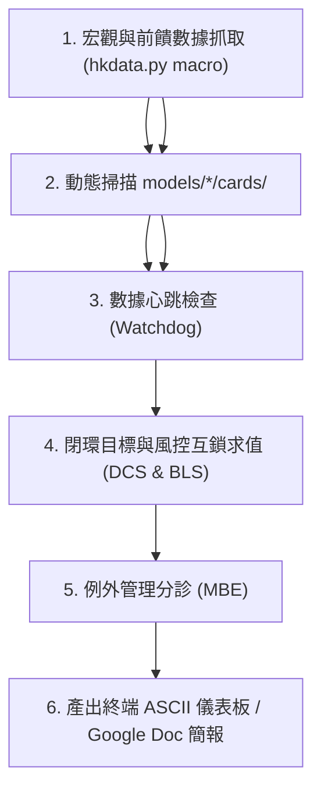

# 投資組合全標的自動巡檢與每日簡報工作流

本工作流為投資組合全標的自動巡檢之標準作業程序（SOP），落實防孤兒架構（Git SSOT），由 Claude 雲端定時排程與 Antigravity 本機日常召喚共用同一套檢測邏輯與簡報規範。

---

## 1. 觸發時機

- **平日盤後例行巡檢**：每個港股/台股交易日 16:30 盤後自動觸發（Claude 雲端平日定時任務，或 Antigravity 本機代班）。
- **隨需巡檢召喚**：使用者於對話框輸入「巡檢全標的」、「每日簡報」、「檢查投資組合」、「資產姿態」、「各標的狀況」時立即執行。
- **重大行情巨震時**：南向資金單日大幅轉向、大盤大幅回檔或核心成分股重大利好/利空發布時。

---

## 2. 標準執行架構與流程



### 步驟 1：執行全標的巡檢核心指令

在 REPO 根目錄執行專屬巡檢腳本：

```bash
# 終端 ASCII 儀表板輸出（預設）
python3 .claude/skills/portfolio-patrol/scripts/patrol.py

# 輸出 Google Doc 標準排版 Markdown 區塊
python3 .claude/skills/portfolio-patrol/scripts/patrol.py --markdown

# 同步寫入每日簡報 Google Doc（原地更新）
python3 .claude/skills/portfolio-patrol/scripts/patrol.py --sync-doc <GOOGLE_DOC_ID>
```

### 步驟 2：例外管理分診（MBE 判定）

巡檢引擎將自動比對各標的之風控互鎖卡片（`interlock_*.yml`）：

1. **優先級 1：高息陷阱斷路 (`TRAP_ALERT`)**
   - 條件：殖利率 $\ge 8\%$ 且多空評分崩跌（$\text{netScore} < 50$ 或 $\text{divScore} < 40$），且前一個交易日同一標的也觸發（兩日確認，見第 8 項）。
   - 處置：頂部大字標記 🚨，暫停額外單筆加碼，維持例行再投入。文字與門檻來源：`.claude/skills/portfolio-patrol/references/interlock_rules.json`。
2. **優先級 2：資金流速急流 (`VELOCITY_PAUSE`)**
   - 條件：南向資金 2 日累計淨流出超過 80 億港元。
   - 處置：暫緩市價大額追買，等待資金流速放緩。
3. **優先級 3：積極進攻姿態 (`AGGRESSIVE_ACCUMULATE`)**
   - 條件：殖利率進入便宜區（$\ge 8.2\%$）且基本面扎實（$\text{netScore} \ge 70$ 且 $\text{divScore} \ge 60$）。
   - 處置：股息 100% 立即再投入，啟動額外本金追加機制。
4. **優先級 4：估值過熱防禦 (`OVERVALUED_HOLD`)**
   - 條件：殖利率 $\le 4.8\%$。
   - 處置：停止追高買進，維持既有部位，股息部分留存現金儲備。
5. **優先級 5：預設穩健複利 (`STEADY_REINVEST`)**
   - 條件：各項指標落於正常基準區間。
   - 處置：精簡一行過關，維持例行性半年配息再投入。
6. **資料不足 (`DATA_INSUFFICIENT`，以優先級 4 的狀態調整列出)**
   - 條件：殖利率 $\ge 8\%$，但成分股財報覆蓋率低於 60%（持股中 ROE、負債比、營業利益率任一有值者，依原始權重計）。
   - 處置：不判定高息陷阱、積極進攻或穩健複利，標示「⚪ 資料不足」，待資料恢復後重新評估。不計入異常跳脫，不觸發互鎖警報。
7. **無資料 (`NO_DIVIDEND_DATA`，以優先級 4 的狀態調整列出)**
   - 條件：收息型或債券型 ETF 的近 12 個月配息為零（配息資料未取得，常見於抓取逾時或來源失敗）。
   - 處置：不歸為成長型，標示「⚪ 無資料」，待下次巡檢取得配息後重新評估。不計入異常跳脫，不觸發互鎖警報。

8. **陷阱觀察 (`TRAP_WATCH`，以優先級 4 的狀態調整列出)**
   - 條件：高息陷阱條件首次成立（殖利率 $\ge 8\%$ 且多空評分破線），尚未經前一個交易日確認。
   - 處置：標示「🟠 陷阱觀察」，不升級為陷阱警戒，不計入異常跳脫。次一交易日仍觸發即升級為 `TRAP_ALERT`。

### 步驟 3：數據心跳時效性把關（Watchdog）

比對 `constituents.jsonl` 與情報庫之時間戳記：

- 若超過 `max_stale_days`（預設 5 個交易日，如週五母表未更），自動於簡報標記警告並通知維護。

### 步驟 4：簡報發布與原地同步

1. **對話框簡報呈現**：輸出排版清晰之 ASCII 表格與決策導引。
2. **Google Doc 每日簡報同步**：維持固定單一真實文件，保留最近 5 個交易日歷史滾動，移除過期舊紀錄，**嚴禁隨意建立散落的孤立文件**。

---

## 3. 防孤兒與安全防線

- **雙執行者同構保證**：Claude 雲端定時排程與 Antigravity 本機日常召喚執行同一支 `scripts/patrol.py`，卡片規則修改立即對雙方生效。
- **嚴格唯讀核心庫**：絕不寫入或變動 `Investment_Tracker_Core`。
- **零隱私洩露**：公開簡報嚴禁記載個人持股張數、總成本、現金餘額或缺口金額，一律採用現價、殖利率（%）、達成率（%）與宏觀指數。
