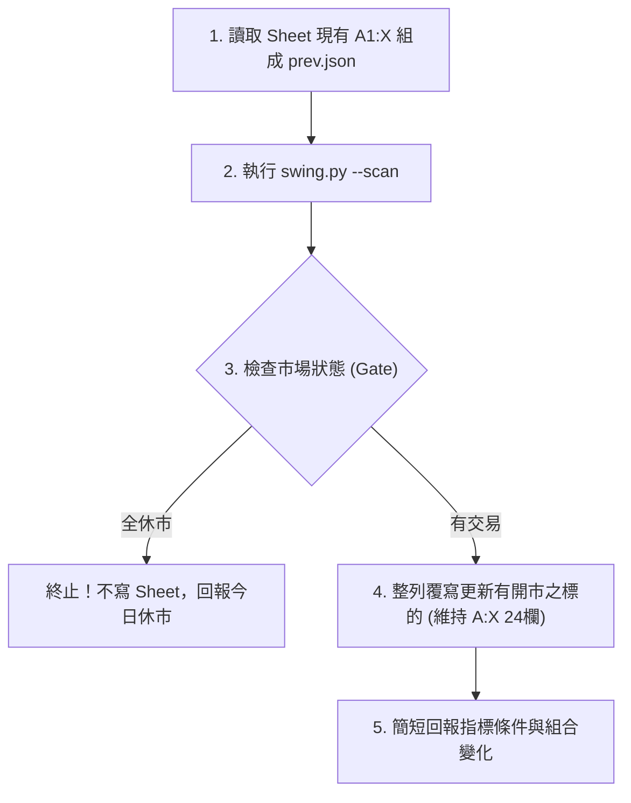

# Stock_AIStudioAPP 波段觀察資料庫排程工作流

本工作流為 Stock_AIStudio APP 波段觀察資料庫之標準作業程序（SOP），規格收斂於 Git REPO 作為單一真實來源（SSOT），於平日港股與台股盤後定時執行，為前端戰情頁提供 24 欄位階、動能與停損防禦資訊。

---

## 1. 觸發時機與排程

- **排程頻率**：每個平日 17:00（台北時間）。
- **觸發平台**：GitHub Actions 自動排程（亦支援 Claude 雲端排程或 Antigravity 本機手動執行）。
- **自動排程工作流**：`.github/workflows/swing-patrol.yml`
- **雲端排程 Prompt（單行呼叫，備用）**：

  ```text
  git pull origin main，讀取並執行 .claude/workflows/swing-patrol-sheets.md，完成後依規格回報。
  ```

---

## 2. 執行前置與環境

- **工作目錄**：REPO 根目錄。
- **前置動作**：`git pull origin main`。
- **產出型態**：**純 Sheet（無 Artifact）**。嚴禁發布或更新任何 Artifact，不碰 `reports/portfolio_briefing.md`。
- **唯讀約束**：只讀取資料，嚴禁寫入 `Investment_Tracker_Core`。

---

## 3. 標準執行步驟



### 步驟 1：讀取前次狀態快照

讀取 Google Sheet「波段觀察」現有資料（A1:X 全部）：

- 使用第 1 欄代號、第 5 欄狀態、第 24 欄三週期組合組成 `/tmp/prev.json`。
- 格式範例：`[{"ticker":"HKG:1919","label":"⚪ 無訊號","combo":"長多短回檔"}, ...]`。
- 若 Sheet 讀不到資料則當作無上次紀錄，不帶 `--prev`。若第 24 欄為空則不寫 combo。

### 步驟 2：執行波段掃描核心指令

在 REPO 根目錄執行：

```bash
python3 .claude/skills/price-dividend-fetcher/scripts/swing.py --scan 00882:15 --prev /tmp/prev.json --sheet /tmp/sheet.json --gate > /tmp/scan.json
```

*若指令執行失敗即停止，不寫入任何資料，於回報中貼出錯誤原因。*

### 步驟 3：健康檢查與市場狀態判定（Gatekeeper）

解析 `/tmp/scan.json` 與 `/tmp/sheet.json`：

1. **全市場休市**：若所有市場的 `fresh` 均為 `false`，整個流程結束，不寫入 Sheet，直接回報「今日休市，未更新」。
2. **單一市場休市**：若某市場（如港股）所有標的的 `fresh` 均為 `false`，該市場在 Sheet 裡的舊資料保持不動。
3. **抓取失敗處理**：若標的 `state` 為 `ERROR`，僅將該列第 5 欄改為「⚠️ 抓取失敗」、第 16 欄寫入原因，其餘欄位（含 R 到 X）**保留舊值**，嚴禁以舊數字冒充今日數據。
4. **互鎖與補跑（`--force`）**：
   - 互鎖機制以各市場最新資料日（`last_date`）比對，若當日資料已成功入庫且數據無異動，預設略過以防重複寫入。
   - **支援手動補跑**：若遇資料異常或需強制重寫，可帶 `--force` 旗標直接穿透互鎖，進行強制整表刷新。

### 步驟 4：寫入 Google Drive 試算表

依據 `architecture/APP讀取清單-Stock_AIStudio.md` 之資料庫註冊表規範：

- **試算表名稱**：`波段觀察`
- **Sheet ID**：`1pyGzkgaspYMYdXOPYerkLsxOMwNwa2yOKuNDrOrrhtQ`
- **分頁名稱**：`Untitled`

#### 欄位鐵律（A 到 X 共 24 欄，欄序嚴格固定）
>
> ⚠️ **前端 APP 契約**：`Stock_AIStudio` APP（`swingFeedService.ts`）以固定欄位索引讀取。**絕對禁止在 A 到 X 範圍內新增、刪除或調換任何欄位！**

表頭順序固定為：

1. `代號` (A)
2. `名稱` (B)
3. `市場` (C)
4. `來源` (D)
5. `狀態` (E)
6. `收盤` (F)
7. `RSI14` (G)
8. `20日線` (H)
9. `60日線` (I)
10. `量比` (J)
11. `52週位置%` (K)
12. `20日支撐` (L)
13. `20日壓力` (M)
14. `2xATR停損價` (N)
15. `停損距離%` (O)
16. `判定依據` (P)
17. `更新日` (Q)
18. `費波那契位置30日` (R)
19. `位置幅度%` (S)
20. `長期` (T)
21. `中期` (U)
22. `短期` (V)
23. `費波那契3段` (W)
24. `三週期組合` (X)

#### 元資料存放規範（最後同步/巡檢時間 Z1:AA2）

- 執行時間戳記與執行者標籤**不得放置於 A:X 欄位內**。
- 同步元資訊統一記錄於 `Untitled!Z1:AA2`（A:X 範圍外）：
  - 正常開市同步：記錄 `最後同步時間` 與 `執行者: GitHub Actions`。
  - 週末/假日休市：記錄 `最後巡檢時間` 與 `狀態: 休市略過（維持最新交易日數據）`。
  - 確保使用者打開試算表可即時確認排程心跳，同時保障 APP 讀取 A:X 時零干擾。

#### 寫入防呆規範

- 以 Sheet 現有列為底對齊代號；有開市的 fresh 列整列覆寫，未更新的列保持原樣。
- 清單新增的標的追加於最末列；清單減少的標的不刪除列，回報即可。

---

## 4. 執行回報規範

完成後輸出簡潔回報：

- 更新了哪些市場、跳過哪些市場與原因、抓取失敗之標的。
- 提醒只看 `alert` 為 `true` 的列（三週期組合變成共振偏多、共振偏空、長多短回檔、長空短反彈）：
  - 條列標的、上次組合 `prev_combo`、這次組合 `combo`、狀態、收盤、2×ATR 停損價。
  - 無變化則回報「今日無組合變化提醒」。
- 嚴格守則：**訊號只客觀描述指標條件，絕不給予買賣指示**。

---

## 5. 雙 Agent 協同分工與代班邊界

- **日常運作**：本任務為「純 Sheet 任務」，日常優先由 **GitHub Actions 自動排程**（`.github/workflows/swing-patrol.yml`）於每個交易日 17:00 自動執行並透過 Google Sheets API 回寫試算表，省下大量 Claude 雲端對話 Token；亦支援 Claude 雲端排程單行呼叫。
- **本機與雲端代班邊界**：本任務無前端 Artifact 綁定。當排程需手動補跑時，可透過 GitHub Actions `workflow_dispatch` 一鍵重跑，或由 **Antigravity 本機執行 `swing_sync.py`** 直寫 Sheet，保障前端 APP 數據心跳不中斷。
