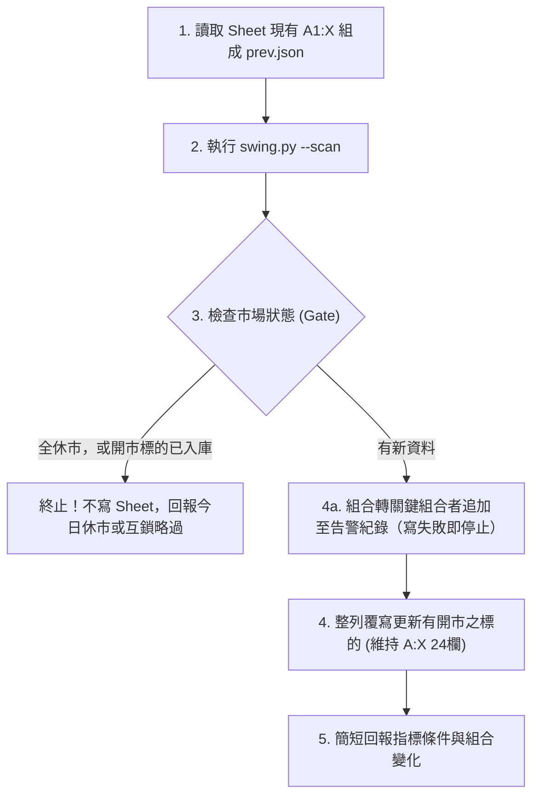

# Stock_AIStudioAPP 波段觀察資料庫排程工作流

本工作流為 Stock_AIStudio APP 波段觀察資料庫之標準作業程序（SOP），規格收斂於 Git REPO 作為單一真實來源（SSOT），於平日港股與台股盤後定時執行，為前端波段觀察頁提供 24 欄位階、動能與停損防禦資訊。

---

## 1. 觸發時機與排程

- **排程頻率**：每個平日 17:23（台北時間；GitHub 實際觸發可能延遲數小時，見 `schedule-registry.md` 第 3 節）。
- **觸發平台**：GitHub Actions 自動排程（亦支援 Antigravity 本機手動執行；Claude 雲端排程已於 2026-11-06 停用）。
- **自動排程工作流**：`.github/workflows/swing-patrol.yml`

---

## 2. 執行前置與環境

- **工作目錄**：REPO 根目錄。
- **前置動作**：`git pull origin main`。
- **產出型態**：**純 Sheet（無 Artifact）**。嚴禁發布或更新任何 Artifact。
- **唯讀約束**：只讀取資料，嚴禁寫入 `Investment_Tracker_Core`。

---

## 3. 標準執行步驟



### 步驟 1：讀取前次狀態快照

讀取 Google Sheet「波段觀察」現有資料（A1:X 全部）：

- 使用第 1 欄代號、第 5 欄狀態、第 24 欄三週期組合組成 `/tmp/prev.json`。
- 格式範例：`[{"ticker":"HKG:1919","label":"⚪ 無明確型態","combo":"長多短回檔"}, ...]`。
- 若 Sheet 讀不到資料則當作無上次紀錄，不帶 `--prev`。若第 24 欄為空則不寫 combo。

### 步驟 2：執行波段掃描核心指令

掃描範圍有兩層（2026-11-06 Hachi 同意）：口袋名單（models 卡片、00882 前 15 大成分股，來源欄為「ETF 卡片」「個股卡片」「00882 成分股」）加全市場 ETF（來源欄為「全市場 ETF」）。全市場 ETF 清單由 `swing_sync.py` 讀全市場 ETF 成分股資料庫（`MARKET_ETF_SHEET_ID`）`ETF_Summary` 的 A、B 欄（只讀），只留台股 ETF 代號、排除查不到資料者（`MARKET_EXCLUDED`，與 Stock_AIStudio 雷達矩陣快照同步）、取前 100 檔，寫成 `/tmp/extra_tickers.json`；讀不到就只掃口袋名單。卡片已有的代號不重複。

在 REPO 根目錄執行：

```bash
python3 .claude/skills/price-dividend-fetcher/scripts/swing.py --scan 00882:15 --tier all --extra-tickers /tmp/extra_tickers.json --prev /tmp/prev.json --sheet /tmp/sheet.json --gate > /tmp/scan.json
```

*若指令執行失敗即停止，不寫入任何資料，於回報中貼出錯誤原因。Gate 判定（2026-11-14 Hachi 同意，取代原本固定 10 檔上限，因為固定檔數會隨清單變長而失準）：*

- 異常列指 `ERROR` 與非新掛牌的 `NO_DATA`（`NO_DATA` 同樣保留舊值，不計入即為靜默失效）。
- 異常列占比超過 20%（`GATE_BLOCK_RATIO`）視為大面積異常，整張表不寫、流程失敗；超過 5%（`GATE_WARN_RATIO`）但未達 20%，正常列照常寫入，日誌警告並列出代號。異常列不擋整張表：保留舊值，`ERROR` 列另標「⚠️ 抓取失敗」。
- 新掛牌不計入異常：以證交所 ETF 上市日期清單判定（`load_listing_dates`，`https://www.twse.com.tw/rwd/zh/ETF/list`），上市距今不超過 100 天（`NEW_LISTING_MAX_DAYS`）且日線不足 60 根才算；上市更久仍日線不足視為抓取異常。上櫃、海外或清單讀取失敗時查不到上市日，退回以日線根數推測並標「未驗證」。上市日之前的佔位日線（價格固定、成交量 0）掃描時剔除，不參與指標計算。
- 核心持股（`publish_gate.json` 的 `zero_tolerance`，目前 00882、00406A）零容忍：缺列、`ERROR`、`NO_DATA`（含新掛牌）任一即回報。其餘列已照常處理、寫入完成後，這次執行以退出碼 1 結束，讓失敗通報送出；清單讀取失敗同樣以失敗結束。
- 每次執行（含成功）都在日誌列出新掛牌（代號、日線根數、上市日或「未驗證」）與異常列（代號、狀態、原因）。掃描結果為空即失敗，拒絕寫入。

### 失敗通報、門檻重播與外部觸發（2026-11-14 Hachi 同意）

- **失敗即時通報**：`swing-patrol.yml` 失敗當下由 `fin-commit/scripts/schedule_notify.py fail` 開 GitHub Issue（標籤 `schedule-failure`，標題「排程失敗：swing-patrol.yml」），附日誌擷取的失敗原因與執行連結；同一工作流只維持一個未關閉的 Issue，再失敗只追加留言；恢復成功後自動留言並關閉。`market-etf.yml` 的排程與 `tw` 手動執行同樣處理。通報本身失敗只警告，不改變排程結果。
- **健康檢查訊息分流**：`schedule_health.py` 的訊息分兩種，「漏跑——…」是沒有如期執行，「已執行但失敗，不是漏跑（含執行連結）」是跑了但結論不是 success。
- **門檻重播**：每次排程把 `/tmp/scan.json` 與門檻判定 `/tmp/scan_gate.json` 存成 artifact `swing-scan`（保存 30 天）。PR 的 CI（`skill-tests`）執行 `price-dividend-fetcher/scripts/gate_replay.py`，用最近 5 份真實掃描結果以目前的門檻重判；當時放行、現在被擋即 CI 失敗。確屬刻意收緊時，PR 描述寫「重播例外」並說明原因即可放行。尚無 artifact 或下載失敗只印提示，不擋 PR。
- **外部觸發（Google Apps Script，備援 GitHub cron）**：同一份腳本也觸發 `market-etf.yml`（週五，見 `market-etf-pool.md` 第 1 節）。GitHub 排程常晚 6 到 10 小時才建立（見 `schedule-registry.md` 待驗證段），所以每個平日台北 17:30 左右由 Google Apps Script 以 `workflow_dispatch` 觸發本工作流；GitHub 自己的 cron 保留當備援，兩者撞到同一天時，互鎖會讓後到的那次略過（不帶 `force`）。設定在 Hachi 的 Google 帳號下，腳本與權杖都不進 git。

  步驟：

  1. GitHub 建立 fine-grained personal access token：只選 `Investment_Tracker` 這個 repository，權限只開 Actions 的 Read and write，到期日一年。
  2. 到 script.google.com 建新專案，專案設定把時區設為 `Asia/Taipei`，「指令碼屬性」新增 `GITHUB_TOKEN`，值貼上第 1 步的權杖。
  3. 貼上下方腳本，儲存後手動執行一次 `triggerSwingPatrol`（會要求授權外部請求與寄信；週末會因平日檢查直接結束，驗證時可暫時註解該行，驗完還原），到 GitHub Actions 確認出現一筆 `workflow_dispatch` 的執行。
  4. 左側「觸發條件」新增兩個：`triggerSwingPatrol`（時間驅動、日計時器、下午 5 點到 6 點）；`triggerMarketEtf`（時間驅動、週計時器、每週五、下午 5 點到 6 點）。
  5. 權杖到期前更換，更換只要改「指令碼屬性」。

  ```javascript
  const REPO = 'HachiTsai/Investment_Tracker';

  // 波段巡檢：台北平日（u：1 到 7 對應週一到週日）
  function triggerSwingPatrol() {
    if (taipeiWeekday_() > 5) return;
    dispatch_('swing-patrol.yml');
  }

  // 全市場 ETF 資料庫：只在台北週五
  function triggerMarketEtf() {
    if (taipeiWeekday_() !== 5) return;
    dispatch_('market-etf.yml');
  }

  function taipeiWeekday_() {
    return Number(Utilities.formatDate(new Date(), 'Asia/Taipei', 'u'));
  }

  function dispatch_(workflow) {
    const token = PropertiesService.getScriptProperties().getProperty('GITHUB_TOKEN');
    if (!token) { notify_(workflow, '找不到指令碼屬性 GITHUB_TOKEN'); return; }
    const res = UrlFetchApp.fetch(
      'https://api.github.com/repos/' + REPO + '/actions/workflows/' + workflow + '/dispatches',
      {
        method: 'post',
        contentType: 'application/json',
        headers: {
          Authorization: 'Bearer ' + token,
          Accept: 'application/vnd.github+json',
          'X-GitHub-Api-Version': '2022-11-28',
        },
        payload: JSON.stringify({ ref: 'main' }),
        muteHttpExceptions: true,
      }
    );
    // 成功固定回 204；其他代碼（權杖過期 401、權限不足 403、工作流不存在 404）寄信通知
    if (res.getResponseCode() !== 204) {
      notify_(workflow, 'HTTP ' + res.getResponseCode() + '：' + res.getContentText().slice(0, 200));
    }
  }

  function notify_(workflow, reason) {
    MailApp.sendEmail(
      Session.getEffectiveUser().getEmail(),
      '[排程觸發失敗] ' + workflow,
      '外部觸發沒有送達 GitHub：' + reason + '\nGitHub 自己的 cron 仍會在稍晚執行；權杖過期請重新建立並更新指令碼屬性。'
    );
  }
  ```

### 步驟 3：健康檢查與市場狀態判定（Gatekeeper）

解析 `/tmp/scan.json` 與 `/tmp/sheet.json`：

1. **全市場休市**：若所有市場的 `fresh` 均為 `false`，且各市場最新資料日距今不超過 10 天（`SHEET_MAX_AGE_DAYS`），整個流程結束，不寫入 Sheet，直接回報「今日休市，未更新」。若最新資料日距今超過 10 天，判定為來源停滯而非休市：流程失敗、不寫入 Sheet，於回報中說明資料日。
2. **單一市場休市**：若某市場（如港股）所有標的的 `fresh` 均為 `false`，該市場在 Sheet 裡的舊資料保持不動。
3. **抓取失敗處理**：若標的 `state` 為 `ERROR`，僅將該列第 5 欄改為「⚠️ 抓取失敗」、第 16 欄寫入原因，其餘欄位（含 R 到 X）**保留舊值**，嚴禁以舊數字冒充今日數據。
4. **互鎖與補跑（`--force`）**：
   - 互鎖機制以各市場最新資料日（`last_date`）比對，若當日資料已成功入庫且數據無異動，預設略過以防重複寫入。
   - **支援手動補跑**：若遇資料異常或需強制重寫，可帶 `--force` 旗標直接穿透互鎖，進行強制整表刷新。
   - 實作（`swing_sync.py` 的 `apply_interlock`）：逐檔比對，本次 `last_date` 不晚於該列 Q 欄（更新日）即略過，不寫入也不告警；Q 欄無法解讀時照常寫入。若全部開市標的都略過、且沒有抓取失敗的列，只更新 Z1:AA2，狀態記為「互鎖略過（資料日已入庫，維持既有數據）」。
   - 手動補跑：`swing-patrol.yml` 的 `workflow_dispatch` 勾選 `force` 即帶 `--force`；自動排程不帶。
   - 漏跑自動補跑：`ci.yml` 每日的排程健康檢查（`schedule_health.py --dispatch`）發現最近一個 cron 時點過 12 小時仍沒有成功執行，就以 `force=true` 補送一次 `workflow_dispatch`（2026-11-09 Hachi 同意，Issue #232）。

### 步驟 4：寫入 Google Drive 試算表

依據 `architecture/APP讀取清單-Stock_AIStudio.md` 之資料庫註冊表規範：

- **試算表名稱**：`波段觀察`
- **Sheet ID**：`SWING_SHEET_ID`（鍵名，實際 ID 在 `DRIVE_IDS`）
- **分頁名稱**：`Untitled`

#### 欄位鐵律（A 到 X 共 24 欄，欄序嚴格固定）
>
> ⚠️ **前端 APP 契約**：`Stock_AIStudio` APP（`swingFeedService.ts`）以固定欄位索引讀取。**絕對禁止在 A 到 X 範圍內新增、刪除或調換任何欄位！**

表頭順序固定為：

1. `代號` (A)
2. `名稱` (B)
3. `市場` (C)
4. `來源` (D)
5. `狀態` (E)
6. `收盤` (F)
7. `RSI14` (G)
8. `20日線` (H)
9. `60日線` (I)
10. `量比` (J)
11. `52週位置%` (K)
12. `20日支撐` (L)
13. `20日壓力` (M)
14. `2xATR停損價` (N)
15. `停損距離%` (O)
16. `判定依據` (P)
17. `更新日` (Q)
18. `費波那契位置30日` (R)
19. `位置幅度%` (S)
20. `長期` (T)
21. `中期` (U)
22. `短期` (V)
23. `費波那契3段` (W)
24. `三週期組合` (X)

#### 元資料存放規範（最後同步/巡檢時間 Z1:AA2）

- 執行時間戳記與執行者標籤**不得放置於 A:X 欄位內**。
- 同步元資訊統一記錄於 `Untitled!Z1:AA2`（A:X 範圍外）：
  - 正常開市同步：記錄 `lastUpdated`（最後同步時間）與 `executor: GitHub Actions`，與程式及架構文件一致。
  - 週末/假日休市：記錄 `最後巡檢時間` 與 `狀態: 休市略過（維持最新交易日數據）`。
  - 互鎖略過（資料日已入庫）：記錄 `最後巡檢時間` 與 `狀態: 互鎖略過（資料日已入庫，維持既有數據）`。
  - 確保使用者打開試算表可即時確認排程心跳，同時保障 APP 讀取 A:X 時零干擾。

#### 寫入防呆規範

- 以 Sheet 現有列為底對齊代號；有開市的 fresh 列整列覆寫，未更新的列保持原樣。
- 清單新增的標的追加於最末列；清單減少的標的不刪除列，回報即可。

#### 告警紀錄（GitHub 排程寫入）

- 由 `swing_sync.py` 執行：三週期組合轉為關鍵組合（`alert`），且本次有寫入新資料（`fresh`）的標的，先追加到「告警紀錄」分頁（A 到 H：偵測時間、代號、名稱、上次組合、這次組合、狀態、收盤、2xATR停損價）。分頁不存在時自動建立並寫入表頭。
- 先寫告警、成功後才覆寫 A 到 X。告警寫入失敗即停止，不覆寫 A 到 X，job 失敗；下次執行會再觸發。
- 若告警已寫入、A 到 X 之後寫入失敗，下次會重複記錄同一筆告警，不會漏記。
- 雲端或本機代班若未使用 `swing_sync.py`，不寫告警紀錄分頁，依第 4 節於回報中列出。

---

## 4. 執行回報規範

完成後輸出簡潔回報：

- 更新了哪些市場、跳過哪些市場與原因、抓取失敗之標的。
- 提醒只看 `alert` 為 `true` 的列（三週期組合變成共振偏多、共振偏空、長多短回檔、長空短反彈）。排程寫入的告警同時記在「告警紀錄」分頁與 GitHub 執行摘要，回報時指向該分頁：
  - 條列標的、上次組合 `prev_combo`、這次組合 `combo`、狀態、收盤、2×ATR 停損價。
  - 無變化則回報「今日無組合變化提醒」。
- 嚴格守則：**訊號只客觀描述指標條件，絕不給予買賣指示**。

---

## 5. 雙 Agent 協同分工與代班邊界

- **日常運作**：本任務為「純 Sheet 任務」，日常優先由 **GitHub Actions 自動排程**（`.github/workflows/swing-patrol.yml`）於每個平日 17:23 自動執行並透過 Google Sheets API 回寫試算表，省下大量 Claude 雲端對話 Token。
- **本機與雲端代班邊界**：本任務無前端 Artifact 綁定。當排程需手動補跑時，可透過 GitHub Actions `workflow_dispatch` 一鍵重跑（需要強制整表刷新時勾選 `force`），或由 **Antigravity 本機執行 `swing_sync.py`** 直寫 Sheet，保障前端 APP 數據心跳不中斷。
