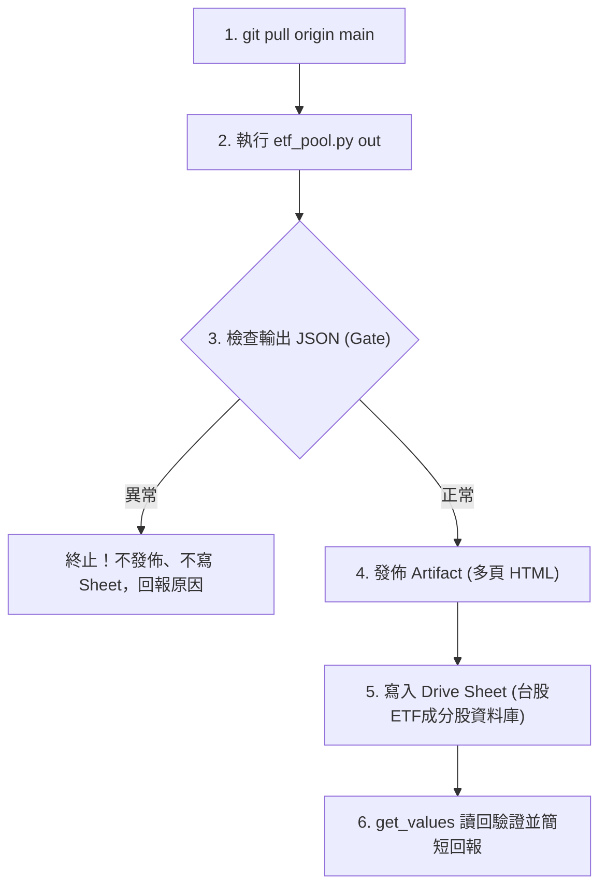

# 台股 ETF 成分股明細與資料池排程工作流

本工作流為台股 ETF 成分股穿透明細與資料池之標準作業程序（SOP），規格收斂於 Git REPO 作為單一真實來源（SSOT），由 Claude 雲端定時排程執行產出，並支援 Antigravity 本機離線驗證。

---

## 1. 觸發時機與排程

- **排程頻率**：每月 1 次（建議每月第 1 個營業日 09:00 執行）。
- **觸發平台**：Claude 雲端排程。
- **雲端排程 Prompt（單行呼叫）**：

  ```text
  git pull origin main，讀取並執行 .claude/workflows/tw-etf-pool.md，完成後依規格回報。
  ```

---

## 2. 執行前置與環境

- **工作目錄**：REPO 根目錄。
- **前置動作**：`git pull origin main`。
- **網路許可網域**（僅雲端沙盒需設）：
  `moneydj.com`, `api.finmindtrade.com`, `google.com`, `query1.finance.yahoo.com`, `www.twse.com.tw`, `www.tpex.org.tw`。
  *註：若 FinMind 需 token，使用網域密鑰 `api.finmindtrade.com`。*

---

## 3. 標準執行步驟



### 步驟 1：執行資料池核心運算

在 REPO 根目錄執行：

```bash
python3 .claude/skills/tw-etf-fetcher/scripts/etf_pool.py out
```

*耗時約 1～2 分鐘，無需背景執行。輸出包含 `out/index.html`、`out/<代號>.html`、`out/pool.json` 與標準輸出之狀態 JSON。*

### 步驟 2：健康檢查門檻判定（Gatekeeper）

解析標準輸出之 JSON 物件，必須滿足以下條件才可繼續：

- `etfs`：約 17 檔。
- `no_price` 與 `no_fin`：合計不超過 10 檔。
- `etfs_with_errors`：必須為空字典 `{}`。

🚨 **異常處置**：若連不上目標網域或失敗檔數超標，**立即停止，不發佈 Artifact 也不寫入 Sheet**，回報具體錯誤與失敗檔數。

### 步驟 3：Artifact 發布（Claude 雲端專屬）

- **目標 URL**：`https://claude.ai/artifact/RoDHVZRr588JCcgzMswsug`
- **主頁檔案**：`out/index.html`
- **關聯多頁**：`files` 帶入 `out/` 底下其餘所有 `.html`（每檔 ETF 一頁），省略 capabilities。

### 步驟 4：寫入 Google Drive 試算表

依據 `architecture/APP讀取清單-Stock_AIStudio.md` 之資料庫註冊表規範：

- **試算表名稱**：`台股ETF成分股資料庫`
- **Sheet ID**：`11LXjxIke0u_6-4XbGB4cX3o28It1ool2jBXUtMErIUI`（位於 `All_Market/Taiwan`）
- **資料來源**：`out/pool.json`

#### 分頁寫入契約

1. **分頁「個股」**：
   - 表頭：`code,name,industry,priceTwd,divTtmTwd,yieldTtmPct,pe,pb,roePct,payoutPct,fcfCover,debtPct,period`
   - 規則：`code` 加 `'` 前綴存成文字；`null` 填空字串。
2. **分頁「ETF持股」**：
   - 表頭：`etf,code,weightPct,shares`
   - 規則：`code` 與 `etf` 加 `'` 前綴存成文字。
3. **分頁「摘要」**：
   - A:C 範圍為 `key,value,note`。
   - key 依序為 `asOf`、`etfs`、`stocks`、`note`、`lastUpdated`、`executor`。
   - B 欄一律加 `'` 前綴存成文字。

#### 寫入防呆規範

- 列數變少時，把多出的舊列清成空字串，**嚴禁刪列**。
- 使用 `update_values` 寫入，不帶 `valueInputOption`。
- 寫完調用 `get_values` 讀回首尾各列確認。

---

## 4. 執行回報規範

完成後以簡潔的一至兩行回報：

- 資料日期、ETF 數、個股數、失敗檔數、Sheet 與 Artifact 是否更新成功。
- 註記：資料為推估，非官方配息；Sheet 只放市場公開資料，不放個人持股。
- **嚴格禁令**：不修改 REPO 與 Core（`Investment_Tracker_Core` 嚴禁寫入）。

---

## 5. 雙 Agent 協同分工與代班邊界

- **日常運作**：本任務為「雙棲任務（Artifact + Sheet）」，日常固定由 **Claude 雲端排程** 統一完成運算、網頁發布與試算表寫入，保持資料時效與視覺一致性。
- **本機代班邊界**：為避免 Artifact 與 Sheet 資料脫節，**Antigravity 本機不單獨代寫此 Sheet**。本機僅負責驗證腳本運算正確性，或於必要時產出 `out/` 推送至分支由雲端發布。
