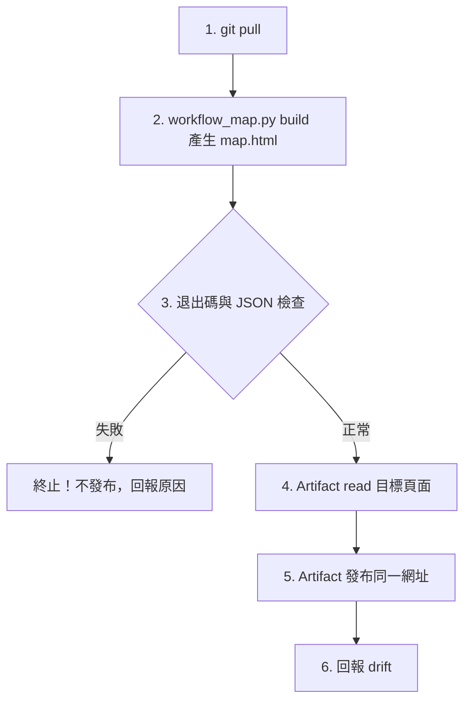

# 工作流對應地圖排程工作流

本工作流讓「工作流對應地圖」Artifact 依 repo 現況定時重產並原地更新。規格收斂於 Git REPO 作為單一真實來源（SSOT），由 Claude 雲端排程執行發布；產生頁面的邏輯在 `fin-commit` 技能的 `workflow_map.py`。

---

## 1. 觸發時機與排程

- **排程頻率**：每週一 09:10（建議值，由 Hachi 在雲端建立排程時決定，建立後同步登記表）；工作流規格、登記表或技能有異動後，也可隨時由 Hachi 說「更新工作流地圖」手動觸發。
- **觸發平台**：Claude 雲端排程。
- **雲端排程 Prompt（單行呼叫）**：

  ```text
  git pull origin main，讀取並執行 .claude/workflows/workflow-map.md，完成後依規格回報。
  ```

---

## 2. 執行前置與環境

- **工作目錄**：REPO 根目錄；前置動作 `git pull origin main`。
- **需要的工具**：Artifact（讀取與發布）。不需要任何連接器，不連外部網路。
- **唯讀約束**：只讀 repo 內檔案，不寫任何試算表，嚴禁碰觸 `Investment_Tracker_Core`；不 commit、不改 repo。
- **目標 Artifact**：`https://claude.ai/artifact/ExaiqRk4EfWJoHe8CeLgY1`（原地更新，不建新頁面）。

---

## 3. 標準執行步驟



### 步驟 1：產生頁面

```bash
python3 .claude/skills/fin-commit/scripts/workflow_map.py build map.html
```

腳本讀取登記表、`.github/workflows/*.yml` 的 cron、`.claude/workflows/*.md` 與 `.claude/skills/*/SKILL.md`，合併 `fin-commit/references/workflow-map-data.json`（人工維護的讀寫對象、產出與序列圖），輸出單檔 HTML 與一段 JSON（`out`、`sha`、`wf_count`、`drift`）。

### 步驟 2：檢查

- 退出碼不為 0、沒有產生 `map.html`，或 `wf_count` 少於 10：**不發布**，回報原因。
- `drift` 非空不擋發布，頁尾已列出不一致處；但要在回報中逐項列出（見步驟 4）。

### 步驟 3：發布

1. 先用 Artifact 工具 `read` 目標網址（讀過才能更新）。
2. 用 Artifact 發布 `map.html`，帶 `url` 為目標網址；重發不傳 `icon`，沿用既有圖示。

### 步驟 4：回報

一至兩行：產生時的 repo 版本（JSON 的 `sha`）、發布成功與否、`drift` 條列。`drift` 代表地圖資料落後 repo（例如新增了工作流規格或技能，地圖還沒收錄）；不要自己改資料檔，列給 Hachi，由他同意後開 PR 更新。

---

## 4. 維護規則

- **地圖資料檔**：`.claude/skills/fin-commit/references/workflow-map-data.json` 是各工作流「讀什麼、寫什麼、產出什麼」的策展資料，版面在同目錄的 `workflow-map-template.html`。新增或改動工作流時，同一個 PR 更新資料檔與登記表。
- **自動對齊的部分**：觸發時間（登記表）、GitHub 排程 cron、待驗證清單（登記表第 3 節）、技能與規格檔清單，每次產生時由 repo 現況取得。
- **公開邊界**：頁面不放金鑰、Drive 或試算表 ID、個人持股與成本；資料檔只寫鍵名與 Artifact 網址。
- 嚴格模式：`workflow_map.py build map.html --strict` 在 `drift` 非空時退出碼 1，供本機或日後 CI 使用。
